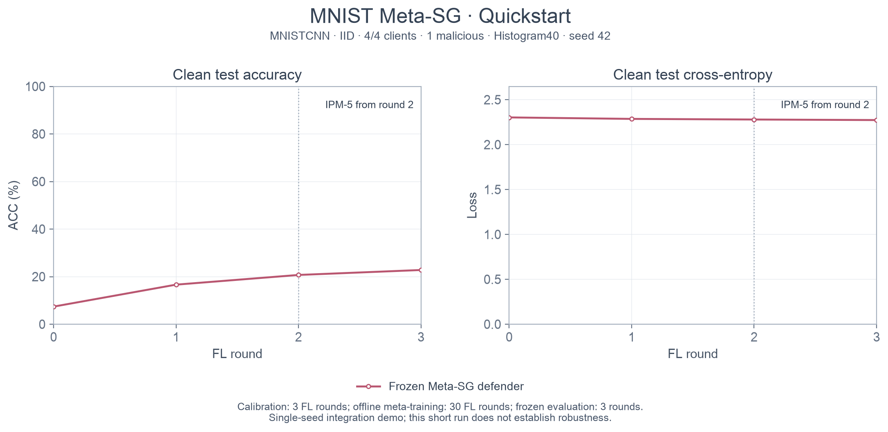

# Quickstart：MNIST Meta-SG

运行一个小预算案例，依次验证真实 MNIST、Histogram40、元训练和冻结策略评估。
完整例子使用一个 seed；没有部署期适应，也不用于判断防御效果。

## 安装

需要 Python 3.11 和 uv，在仓库根目录执行：

```bash
uv sync --locked --group dev --extra rl --extra plots
uv run --locked --extra rl pytest -q
```

## 运行

训练在开发机执行。先确认资源，再进行冒烟验证：

```bash
uv run --locked --extra rl python scripts/quickstart.py --device cuda --smoke --output Outputs/runs/quickstart-smoke
```

冒烟成功后执行 Demo：

```bash
uv run --locked --extra rl python scripts/quickstart.py --device cuda
uv run --locked --extra rl --extra plots python scripts/plot_quickstart.py
```

默认会下载 MNIST 至 `data/`。已有数据时追加 `--data-root /path/to/data`，该目录应包含 `MNIST/raw/`。
开发机没有 CUDA 时可以显式使用 `--device cpu`。新实验要求输出目录为空；重复执行时用 `--output Outputs/runs/quickstart-2`，绘图同步传入 `--run Outputs/runs/quickstart-2`。

单独检查普通配置而不启动训练：

```bash
uv run --locked --extra rl meta-sg --config configs/quickstart.json --dry-run
```

## 执行内容

[quickstart.json](configs/quickstart.json) 固定 MNISTCNN、IID、4 客户端全参与、1 个恶意身份、batch 32、正常本地 SGD 1 步、root SGD 1 步、学习率 0.05、seed 42。root 每类 10 张，从客户端训练数据中排除。TD3 使用两层 16 单元网络，batch 4、replay 64。

1. **校准 3 轮**：固定动作 Defender，以训练 root 和客户端更新收集 C/N/B/Z 特征。
2. **冻结 Histogram40**：仅在上述训练特征上拟合分箱。短程校准不足以稳定估计逐箱标准差，因此本例不做输入标准化，输入保留 0～1 的分箱占比；不改变正式配置的默认行为。
3. **元训练 1 次外循环**：RL 模型投毒、BRL 后门各有独立 follower。每任务 Defender 任务内更新 2 次、follower 响应 2 次、响应后 critic 拟合 2 步；每条轨迹 3 轮，共 10 条轨迹、30 个离线元训练 FL 轮次。Actor 根据响应后的梯度更新共享初始化。BRL 目标为 2、源为所有非目标类别。
4. **冻结评估 3 轮**：分类器重新初始化，Defender 策略冻结；第 2 轮起执行 IPM-5。独立测试集给出 ACC 与损失，不反馈给策略训练。这里评估的是冻结策略，不包含部署期适应或后门 ASR 评估。

共执行 36 个 FL 轮次：校准 3 + 离线元训练 30 + 冻结评估 3。冒烟版本为 2 + 12 + 2，共 16 轮。

## 已运行结果

在开发机 RTX 3090 上完成冒烟后运行 Demo，耗时约 **6.63 秒**，不含安装和下载。
冻结评估的测试 ACC 从 **7.39%** 变为 **22.79%**；末轮交叉熵为 **2.27316**。
外层 Actor 参数变化 L2 为 **0.03794**；两个任务均实际执行了任务内 Actor 更新、follower Actor 响应及响应后梯度计算。

该预算仅演示接口连通，以上数值不代表收敛性能、历史复现或跨攻击泛化结论。设备和数值库版本变化也可能改变具体数值。



[PDF](Outputs/quickstart/mnist_meta_demo_v1.pdf) · [SVG](Outputs/quickstart/mnist_meta_demo_v1.svg) · [执行摘要](Outputs/quickstart/run/summary.json) · [逐轮评估](Outputs/quickstart/run/evaluation/metrics.jsonl) · [元训练记录](Outputs/quickstart/run/meta/metrics.jsonl)

## 输出与恢复

每次新运行写入 `Outputs/runs/quickstart/`：

| 路径 | 内容 |
| --- | --- |
| `calibration/` | 校准配置、逐轮特征与指标、划分和检查点 |
| `histogram40.json` | 训练期拟合后冻结的分箱 |
| `meta/` | 元训练日志、完整外循环检查点和策略导出 |
| `evaluation/` | 冻结策略在 IPM 下的测试指标和检查点 |
| `summary.json`, `code_hashes.json` | 参数变化、轮次成本、运行环境、验证结果和源码哈希 |

元训练中断时可恢复到最后保存的完整外循环边界：

```bash
uv run --locked --extra rl meta-sg-meta --resume Outputs/runs/quickstart/meta/latest.pt
```

Quickstart 总脚本不自动续跑各阶段；需要完整重跑时指定一个新目录。恢复接口详见 [元训练说明](src/meta_sg/rl/META.md)。
Git 中的 `Outputs/quickstart/` 是此次运行的精选指标与图片；完整检查点保存在开发机执行目录，日常 `Outputs/runs/` 不加入 Git。

## 历史资料

[Meta-SG 研究与实验文档](Meta-SG.md) 独立保存历史配置与结论，所用图片、表格及可定位的本地原始指标位于 [Outputs/archive](Outputs/archive/manifest.json)。这些历史结果由旧代码产生，与本 Quickstart 的短程运行分别记录。
