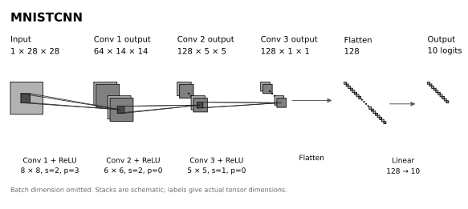

# MNIST

This directory contains MNIST loading and preprocessing, the classifier, and its architecture diagram.

## Dataset

MNIST contains grayscale images of handwritten digits, with one label from 0 to 9 per image.

| Property | Value |
| --- | --- |
| Training examples | 60,000 |
| Test examples | 10,000 |
| Classes | 10 |
| Image size | 28 × 28, one channel |
| Raw pixel type | `uint8` |

Dataset dimensions and split sizes: [TensorFlow Datasets MNIST catalog](https://www.tensorflow.org/datasets/catalog/mnist).
The existing experiments load the training and test splits through [Torchvision MNIST](https://docs.pytorch.org/vision/stable/generated/torchvision.datasets.MNIST.html).

### Input convention

The existing MNIST experiment converts raw pixels to floating point and normalizes them as:

```text
x = (pixels / 255 - 0.1307) / 0.3081
```

A channel dimension is added to produce `[batch, 1, 28, 28]` inputs.
Preprocessing belongs to the data pipeline; the model receives these tensors directly.
[data.py](data.py) provides `load_mnist(data_root, download=False)`, returning the official training and test datasets with this preprocessing.
The shared [data module](../../data/README.md) provides trusted root sampling and IID or Dirichlet client partitioning.
[triggers.py](triggers.py) provides the four DBA sub-triggers and their union in normalized pixel space, using the same mean/std as the loader.

## Model



Diagram adapted from [Gavin Weiguang Ding's draw_convnet template](https://github.com/gwding/draw_convnet),
with layers and dimensions set to this model. The template's BSD-3-Clause notice is preserved in the SVG metadata.

[model.py](model.py) preserves the existing classifier: three convolution–ReLU stages, flattening, and a linear classifier.
It has 710,218 trainable parameters. Convolution and linear weights use Xavier-uniform initialization; biases start at zero.
The output is `[batch, 10]` raw logits for cross-entropy loss.

```python
import torch

from meta_sg.datasets.mnist import MNISTCNN

model = MNISTCNN()
logits = model(torch.randn(4, 1, 28, 28))  # Shape: [4, 10]
```
